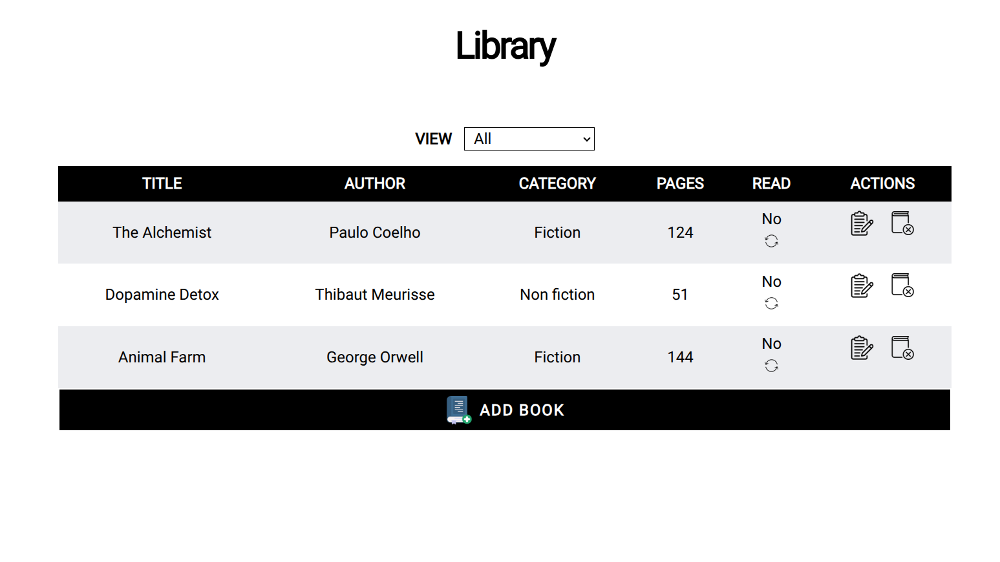
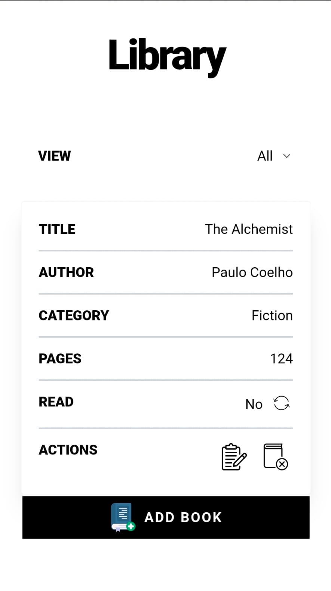

# Library

  
  

A lightweight, responsive personal library tracker built with HTML, TailwindCSS, and JavaScript. Keep a record of the books you have, organize them by category, and update your reading status as you go. Your library is saved in your browser, so it remains available when you return.

## Features

- Add books with a title, author, category, page count, and read status
- Edit book details after adding them
- Mark books as read or unread
- Remove books from your library
- Filter the library by category or view all books
- Automatically save your library in browser `localStorage`
- Use a card layout on small screens and a table layout on larger screens

## Categories

Books can be organized as Uncategorized, Fiction, Non fiction, Poetry, or Drama.

## Tech Stack

- HTML
- Tailwind CSS
- JavaScript
- Browser `localStorage` for persistence

## How to Use

- Add a book by entering its title, author, and page count, then choose a category and reading status.
- Use the **View** selector to show all books or filter by category.
- Use the read-status control to switch a book between read and unread.
- Choose the edit or remove action to update or delete a book.

Your book data is stored locally in the browser. It is not synced between browsers or devices.
